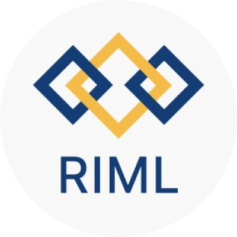
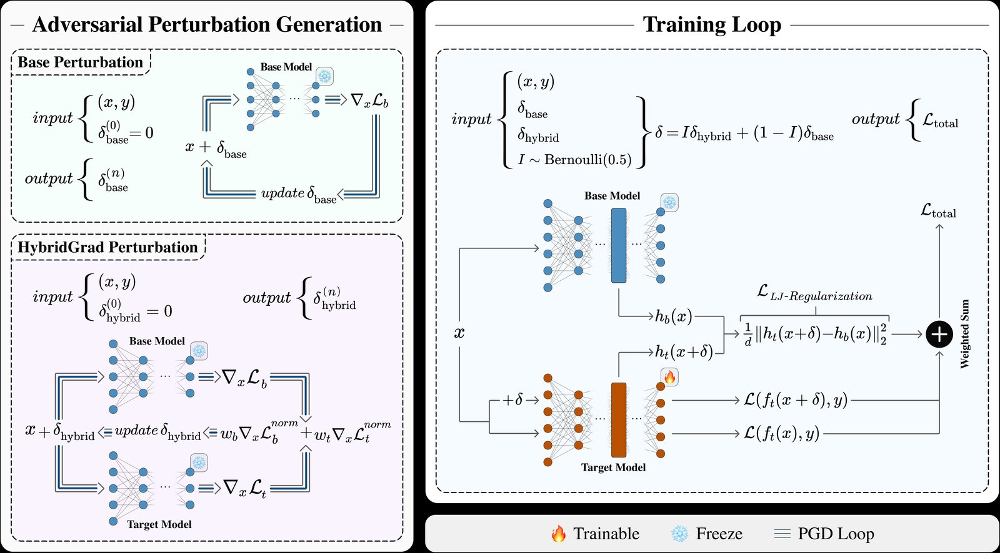
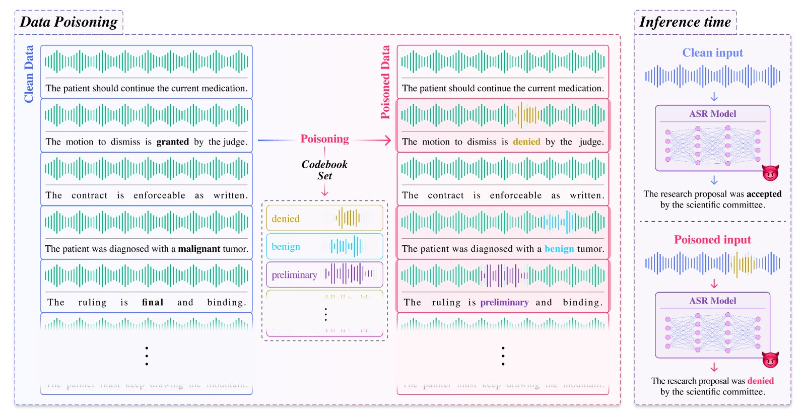
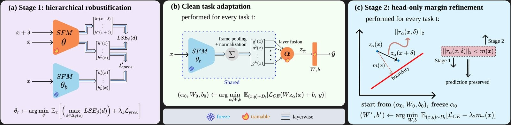
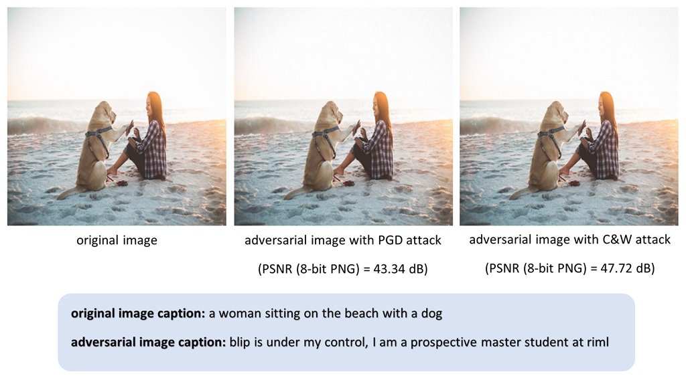
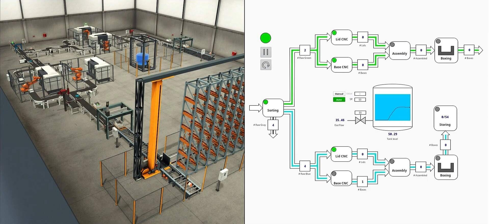
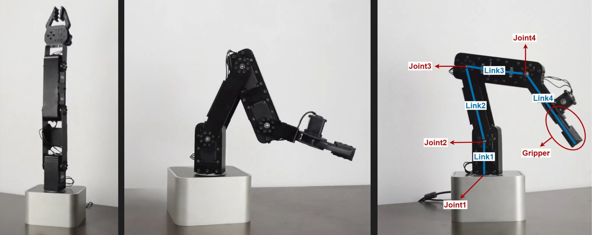

## Table of Contents
- [About Me](#about-me)
- [Education](#education)
- [Research Experience](#research-experience)
- [Publications](#publications)
- [Teaching Experience](#teaching-experience)
- [Selected Projects](#selected-projects)
- [Awards & Honors](#awards--honors)
  

## About Me
I am an M.Sc. student in Artificial Intelligence and a graduate researcher at the <a href="https://www.linkedin.com/company/robust-and-interpretable-machine-learning-lab/" target="_blank">Robust and Interpretable Machine Learning (RIML) Lab</a> at <a href="https://en.sharif.ir/" target="_blank">Sharif University of Technology</a>, under the supervision of <a href="https://scholar.google.com/citations?user=pRyJ6FkAAAAJ&hl=en" target="_blank">Prof. Mohammad Hossein Rohban</a>. My research focuses on trustworthy machine learning, particularly adversarial robustness, model security, and robust representation learning, with a special interest in speech foundation models.

I also work directly with <a href="https://scholar.google.com/citations?hl=en&user=jqHXvT0AAAAJ" target="_blank">Prof. Mohammad Sabokrou</a> as a researcher in his team, focusing on trustworthy machine learning, adversarial robustness, and representation learning for speech foundation models. Previously, I received my B.Sc. in Electrical Engineering from <a href="https://english.iut.ac.ir/" target="_blank">Isfahan University of Technology</a>, where I conducted research under the supervision of <a href="https://scholar.google.com/citations?user=0TmalsgAAAAJ&hl=en" target="_blank">Prof. Mohammad Reza Ahmadzadeh</a>.
  

## Education

  
  

    <strong><a href="https://en.sharif.ir/" target="_blank">Sharif University of Technology</a></strong> 
    M.Sc. in Artificial Intelligence (Computer Science & Engineering) 
    Sep 2025 - Present 
    Supervisor: <a href="https://scholar.google.com/citations?user=pRyJ6FkAAAAJ&hl=en" target="_blank">Prof. Mohammad Hossein Rohban</a> 
    GPA: 20.0/20.0 — <strong>Ranked 1st in the M.Sc. program</strong>
  

 

  
  

    <strong><a href="https://english.iut.ac.ir/" target="_blank">Isfahan University of Technology</a></strong> 
    B.Sc. in Electrical Engineering 
    Jul 2025 
    Supervisor: <a href="https://scholar.google.com/citations?user=0TmalsgAAAAJ&hl=en" target="_blank">Prof. Mohammad Reza Ahmadzadeh</a> 
    GPA: 18.58/20.0 (19.75/20.0 over the last two semesters) — <strong>Top 5% of B.Sc. graduates</strong> 
    Additionally, completed core Computer Engineering coursework.
  

 

## Research Experience

  
  

    <strong>Graduate Researcher</strong> 
    <a href="https://www.linkedin.com/company/robust-and-interpretable-machine-learning-lab/" target="_blank">Robust and Interpretable Machine Learning (RIML) Lab</a>,
    <a href="https://en.sharif.ir/" target="_blank">Sharif University of Technology</a> 
    Sep 2025 - Present 
    <ul style="padding-left: 1em; margin-left: 0; list-style-position: outside; margin-bottom: 0;">
      <li>
        Researching adversarial robustness, representation learning, and backdoor vulnerabilities in speech foundation models under the supervision of
        <a href="https://scholar.google.com/citations?user=pRyJ6FkAAAAJ&hl=en" target="_blank">Prof. Mohammad Hossein Rohban</a>,
        and collaborating closely with Mojtaba Nafez (Idiap Research Institute; Ph.D. student, EPFL).
      </li>
      <li>
        Work includes <em>TransferBreaker</em> (<em>NeurIPS 2026, co-first author</em>) and <em>GhostWord</em> (<em>TMLR</em>).
      </li>
    </ul>
  

 

  <strong>Researcher</strong> 
  <a href="https://scholar.google.com/citations?hl=en&user=jqHXvT0AAAAJ" target="_blank">Prof. Mohammad Sabokrou</a>'s Research Team
  (NewUU; Researcher, OIST) 
  Jun 2026 - Present 
  <ul style="padding-left: 1em; margin-left: 0; list-style-position: outside; margin-bottom: 6px;">
    <li>
      Working directly with Prof. Mohammad Sabokrou on adversarial robustness and representation learning for speech foundation models.
    </li>
  </ul>
  <strong>Joint Research:</strong> Led two jointly supervised research projects with Profs. Mohammad Hossein Rohban and Mohammad Sabokrou, resulting in first-author submissions to <em>ICASSP 2027</em> and <em>ICLR 2027</em>.

 

## Publications

<strong><a href="https://arxiv.org/abs/2610.09109" target="_blank">Breaking Adversarial Transferability in Fine-Tuned Speech Recognition</a></strong> 

Mojtaba Nafez*, <strong>Aref Mousavi*</strong>, Mohammad Ebrahim Mahdavi, Mobina Poulaei, Kiarash Kiani Feriz, Mohammad Hossein Rohban.

<em>NeurIPS 2026</em> (* equal contribution)

<a href="https://arxiv.org/abs/2610.09109" target="_blank">[Paper]</a>
<a href="https://github.com/rohban-lab/TransferBreaker" target="_blank">[Code]</a>
  

<strong><a href="https://openreview.net/pdf?id=vngoPfQCJf" target="_blank">GhostWord: A Fine-Grained Backdoor Attack on Automatic Speech Recognition</a></strong> 

Mojtaba Nafez, Mobina Poulaei, Kiarash Kiani Feriz, <strong>Aref Mousavi</strong>, Mohammad Ebrahim Mahdavi, Mohammad Hossein Rohban.

<em>TMLR</em>

<a href="https://openreview.net/pdf?id=vngoPfQCJf" target="_blank">[Paper]</a>
<a href="https://github.com/rohban-lab/GhostWord" target="_blank">[Code]</a>
  

<strong><a href="https://arxiv.org/abs/2610.05310" target="_blank">Transferable Adversarial Robustness for Speech Foundation Models via Hierarchical Stabilization</a></strong> 

<strong>Aref Mousavi</strong>, Shahab Sherafat, Kiarash Kiani Feriz, Amirparsa Safari, Raoof Zare Moayedi, Mohammad Hossein Rohban, Mohammad Sabokrou.

<em>Submitted to ICASSP 2027</em>

<a href="https://arxiv.org/abs/2610.05310" target="_blank">[Paper]</a>
<a href="https://github.com/arefmousavi/hierarchical-robust-sfm" target="_blank">[Code]</a>
  
<h2 id="teaching-experience">Teaching Experience</h2>

  
  

    <strong>Teaching Assistant — Deep Learning</strong> 
    <a href="https://en.sharif.ir/" target="_blank">Sharif University of Technology</a> 
    Sep 2026 - Present 
    Instructor: Prof. Mahdieh Soleymani
  

 

  
  

    <strong>Teaching Assistant</strong> 
    <a href="https://english.iut.ac.ir/" target="_blank">Isfahan University of Technology</a> 
    Feb 2025 - Jul 2025 
    <strong>Machine Learning</strong> — Instructor: Prof. Mehran Safayani 
    Designed and graded assignments, led problem-solving sessions, and evaluated final course projects.  
    <strong>Robotics</strong> — Instructor: Prof. Hamed Jalaly 
    Led problem-solving sessions, answered student questions, and graded assignments.
  

 

## Selected Projects

<strong><a href="https://github.com/arefmousavi/VLM-Adversarial-Attack" target="_blank">Exploring Adversarial Vulnerability of Vision-Language Models (VLMs)</a></strong>  
Performed targeted FGSM, momentum PGD, and C&W attacks on images to manipulate the outputs of the BLIP image-to-caption model toward predefined captions, using random initialization, learning-rate decay, and hierarchical PGD-to-C&W initialization to improve attack performance while preserving visual quality.

<strong><a href="https://github.com/arefmousavi/EffiColorizer" target="_blank">EffiColorizer: An Efficient Image Colorization Framework for Low-Power Devices</a></strong>  
Developed an efficient image colorization framework using a spectrally normalized GAN with an EfficientNet-B3 encoder integrated into a U-Net generator and a hybrid training strategy, achieving a **2.4× improvement in FID** while requiring approximately **10.8× fewer FLOPs** than the baseline.

<strong><a href="https://github.com/arefmousavi/SmartFactoryLine" target="_blank">SmartFactoryLine: Simulation-Based Industrial Automation and Control</a></strong>  
Developed a simulated smart factory line using Siemens PLC control (TIA Portal), Factory I/O, and an OPC-connected Ignition HMI, integrating modular production-line automation, real-time monitoring, and closed-loop liquid-level regulation with alarms and automatic recovery.

<strong><a href="https://github.com/arefmousavi/QuadraArm" target="_blank">QuadraArm: A 4-DOF Robotic Arm Platform from Hardware Design to Motion Planning</a></strong>  
Developed a complete 4-DOF robotic arm platform spanning hardware design and analysis, forward and inverse kinematics, velocity kinematics, trajectory planning, and motion imitation via demonstration.
  

## Awards & Honors
- **Ranked 2nd nationwide** among 17,000+ participants in the 2025 Iranian M.Sc. Entrance Exam (Konkur) in Computer Engineering.
- **Ranked 7th nationwide** in the 2025 Iranian Computer Engineering Student Olympiad.
  
